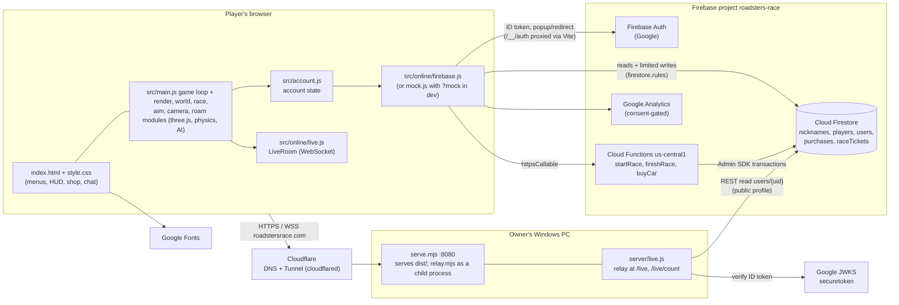
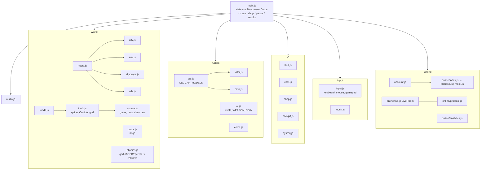

# 4. Architecture

[← Index](TECHNICAL_DOCUMENTATION.md)

## 4.1 System context

[confirmed: `vite.config.js`, `server/live.js:65,94,270-287`, `src/online/firebase.js:31-41`, `functions/index.js:32,48,86`, `index.html`]

## 4.2 Responsibilities and trust boundaries

| Component | Runs on | Trusted for | Not trusted for |
|---|---|---|---|
| Browser game (`src/`) | player's device | rendering, physics, AI, input, race simulation | **anything** that reaches the server; the server must check it |
| `firestore.rules` | Firebase | the only check on direct client writes (rename, kill award, killer status, profile create, private info) | — |
| Cloud Functions | Firebase (Google) | **coins** (race rewards, purchases), best times, roads won, ticket timing | the race result itself: it is client-reported and only plausibility-checked |
| Relay `server/live.js` | owner's PC, in the Vite process | identity (verifies the Google ID token), rate limits, kill crediting (kills follow own shots, 2 s per victim), killer counting | hit detection: the shooter decides hits (protocol 4) |
| Cloudflare Tunnel | Cloudflare + `cloudflared` on the PC | TLS, public hostname | no WAF or rate-limit config is in the repo [unknown] |

Key design decisions [inferred from comments and changelog]:

1. **Serverless economy, PC-hosted realtime.** The coin economy moved server-side in v0.2 (milestone M8), with Cloud Functions plus a `raceTickets` timer. Realtime FREE ROAM stays on the PC because it is cheap and needs no paid infrastructure (`server/live.js:47`: "keeps the upload from this PC reasonable").
2. **The relay is its own process (since v0.2.4, R6).** In production `server/serve.mjs` serves the static files and starts `server/relay.mjs` (the relay from `server/live.js`) as a child process on `127.0.0.1:8091`, passing `/live` and `/live/count` to it; a crashed relay is restarted without touching the website. On the dev server `livePlugin` still attaches the relay to Vite (`vite.config.js`).
3. **Relay without the Admin SDK.** The relay verifies tokens with JWKS and reads public profiles through the Firestore REST API (`server/live.js` `identify`). **It saves kills and KILLER STATUS itself** (since v0.2.4, R7) through the `relayKills` function, signed with a shared secret (`RELAY_SECRET`); the browser can no longer write them (see [Security](07-security.md)).
4. **One map.** SKYLINE CITY only; R1/R3 maps are archived outside the repo (`maps.js` has one entry) [confirmed: `src/maps.js:8`].

## 4.3 Client internal architecture

[confirmed: imports in `src/main.js`; file roles taken from module headers]

**Game loop** [confirmed: `src/main.js` `frame`; rules in `race.js`, weapons in `aim.js`, cameras in `camera.js`, FREE ROAM in `roam.js`]: `requestAnimationFrame` → read input → step the player and rivals (`stepRacer`) or the FREE ROAM car → physics against the collider grid → weapons → HUD → render. Graphics quality is `GFX.high` or `GFX.low` (`src/render.js` `GFX`), with automatic switching to low if the frame rate stays under 40 fps after 3 s (`src/render.js` `measureGfx`). Details: `docs/technical/02-game-loop.md`.

## 4.4 Online state ownership

| State | Owner (source of truth) | Copies |
|---|---|---|
| Coins (`totalCoins`), best times, roads won, owned cars | Firestore `users/{uid}`, written **only** by Cloud Functions | `account.profile` (live `onSnapshot`) |
| Nickname | `users/{uid}.nickname` + `nicknames/{lower}` (claimed in a client transaction under rules) | profile |
| Lifetime kills, KILLER STATUS | `users/{uid}.kills` / `isKiller` / `killerKillCount`, written **only** by the relay through `relayKills` (v0.2.4) | profile; `account.pendingKills` shows kills not saved yet |
| Killer status | relay counts (`p.kc`), **client saves** `isKiller` / `killerKillCount` | profile |
| FREE ROAM positions, health, shots | client-authoritative, relayed at 15/s | remote avatars interpolated with 0.15 s delay |
| Race in progress | client only; server keeps only the ticket start time | — |
| Settings (gfx, sens, volume, …) | `localStorage` per device | — |
