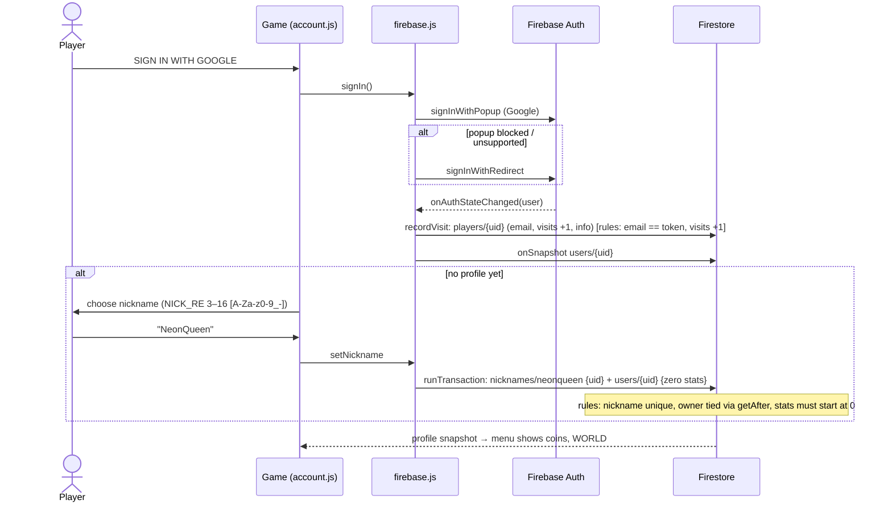
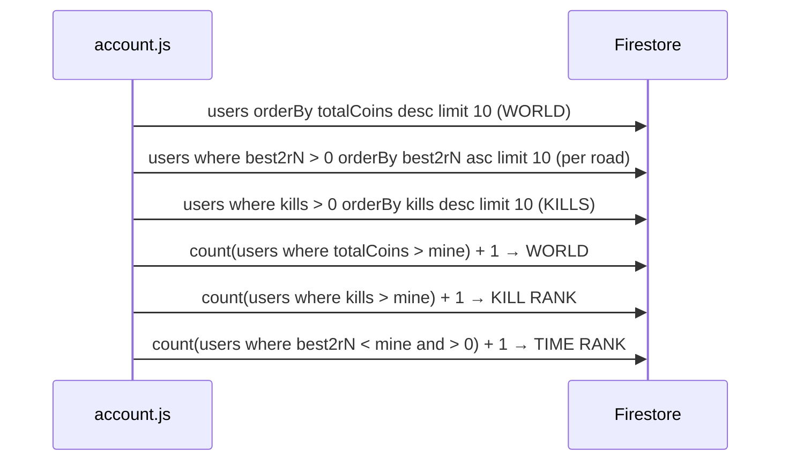

# 6. Core workflows

[← Index](TECHNICAL_DOCUMENTATION.md)

All diagrams follow the code paths cited under each one [confirmed unless marked].

## 6.1 Sign-in, visit record and nickname



Sources: `src/online/firebase.js:57-127`, `firestore.rules:22-65`, `src/online/index.js:4`. Renaming uses the same transaction: it deletes the old `nicknames` doc and updates `nickname` / `nicknameLower` (`firestore.rules` `isRename`).

## 6.2 Race and saving coins (server-checked, since v0.2 / M8)

```mermaid
sequenceDiagram
  actor P as Player
  participant G as main.js / race.js + account.js
  participant F as Cloud Functions
  participant FS as Firestore
  P->>G: start RACE on road N
  G->>F: startRace {mode:'race', road:N} (15 s timeout)
  F->>FS: tx: raceTickets/{uid} = {ticket UUID, mode, road, startedAt: serverTime}
  Note over F: refused (resource-exhausted 'too-fast') if the last ticket is < 3 s old
  F-->>G: {ticket}
  Note over G: race runs entirely in the browser (2 laps, 10 AI rivals, coins on track)
  G->>G: results screen → recordRace(coins, bestLap, raceTime, place)
  alt signed out / no ticket
    G->>P: "COINS EARNED · NOT SAVED"
  else no profile yet
    G->>P: "CHOOSE NICKNAME TO SAVE" (pending kept)
  else
    G->>F: finishRace {ticket, coins, bestLap, raceTime, place}
    F->>FS: tx: read raceTickets/{uid} + users/{uid}
    Note over F: checks: ticket matches; age ≤ 45 min; last saved race ≥ 60 s ago (120 s before v0.2.1);<br/>coins only if mode race and elapsed ≥ 60 s, floor, cap 200;<br/>bestLap ≥ 30 and ≤ elapsed+1; raceTime ≥ 60 and ≤ elapsed+1;<br/>place 1 → roadsWon = max(roadsWon, N)
    F->>FS: delete ticket; update coins, totalCoins, races, lastRaceAt, bestLap, best2/best2rN, roadsWon
    F-->>G: {gain, coins, totalCoins}
    G->>FS: myRank (count users with more totalCoins)
    G->>P: "SAVED +gain · WALLET … · WORLD RANK #"
  end
```

Sources: `src/account.js:358-449`, `functions/index.js:32-83`, `functions/rules.js:5-17`.

Notes:
- The coin **count** is client-reported; the server only caps it (200) and checks timing [confirmed]. A cheat can claim 200 coins per race once every 2 minutes (see [Security](07-security.md)).
- TIME ATTACK (`mode: 'attack'`) earns no coins and doesn't update `best2*`, but can set `bestLap` [confirmed: `functions/index.js:64-77`].
- `too-soon` (inside the 60 s gap, `RACE_GAP_S`; 120 s before v0.2.1): the client keeps the race, shows *RACES TOO CLOSE TOGETHER · SAVING IN N S* and saves it when the gap has passed; the ticket survives a too-soon refusal [confirmed: `src/account.js` `flushPending`; fixed after v0.2, see D3].
- The server holds **one ticket per player**. `account.startRace` therefore waits for a save still in flight (`account.awarding`) before requesting the next ticket, so RACE AGAIN can't replace the ticket under a slow `finishRace` (D15). A failed ticket request is retried once after 3.5 s.

## 6.3 Buying a car

```mermaid
sequenceDiagram
  actor P as Player
  participant S as shop.js / account.js
  participant F as buyCar
  participant FS as Firestore
  P->>S: BUY VIPER (price shown from SHOP_CARS)
  S->>F: buyCar {id:'viper'} (15 s timeout)
  F->>F: price = SHOP_PRICES[id] or SKIN_PRICES[id] (skins, v0.2.28) or NITRO_PRICES[id] (nitros, v0.3.2) or INTERIOR_PRICES[id] (interiors, v0.3.3) or invalid-argument
  F->>FS: tx: read users/{uid}
  Note over F: already-exists if owned; failed-precondition 'funds' if coins < price
  F->>FS: coins −price, cars ∪ id (a skin: skins ∪ id; a nitro: nitros ∪ id); create users/{uid}/purchases/{auto} {item, price, coinsBefore, at}
  F-->>S: {coins}
  S->>P: car unlocked; equip stored in localStorage neon.car (a skin: neon.skin.<car>; a nitro: neon.nitro.<car>)
```

Sources: `src/account.js:72`, `functions/index.js:86-103`, `functions/rules.js:20`, `src/shop.js:9`. `totalCoins` (the ranking) is not reduced by spending [confirmed].

## 6.4 FREE ROAM: join, play, kill, KILLER STATUS

```mermaid
sequenceDiagram
  participant A as Player A (LiveRoom)
  participant R as Relay /live
  participant G as Google JWKS
  participant FS as Firestore REST
  participant B as Player B
  A->>R: WebSocket upgrade /live (via Cloudflare)
  A->>R: hi {token: Firebase ID token, c: color, car, skin, nitro, v: LIVE_PROTOCOL (18)}
  Note over R: v ≠ LIVE_PROTOCOL → err 'old' (client reloads, at most once a minute)
  R->>G: jwtVerify (issuer/audience = project)
  R->>FS: GET users/{uid} (8 s timeout) → nickname, isKiller, killerKillCount
  alt no nickname → err 'nickname'; full (24) → err 'full'; same uid elsewhere → old tab gets err 'again'
  end
  R-->>A: welcome {id, name, n, slot, x, kc, car, skin, nitro}
  R-->>A: join … (each player already there)
  R-->>B: join {id A, name, c, car, skin, nitro, k:0, x, kc}
  loop every 66 ms (15/s), 500 ms when idle
    A->>R: s [x,y,z, yaw, pitch, roll, speed, boost, …, hp (ignored since v0.3)]
    R-->>A: w {n, p:[[id, …state, the relay's hp %]]} (tick 15/s)
  end
  A->>R: f {k:'missile', o, d, tg}
  R-->>B: f {id A, …}
  A->>R: hit {v: B, k, d} (only ≤ 5 s after A's own shot)
  Note over R: health.js (S4, v0.3): protected / dodging? else damage
  R-->>B: hit {id A, k, d, r: hit|wreck|dodged, hp}
  Note over B: B shows it (knock-back, health bar)
  Note over R: hp ≤ 0 → wreck: B down 3 s, then full hp; A.kills++, A.kc++
  R-->>A: kill {k:A, v:B, n, kc} (to everyone; B explodes on it)
  R->>FS: 3 s later: relayKills {uid A, kills +n, kc, killer} (shared secret)
  opt A.kc reaches 3
    R-->>A: killer {id:A, on:true, kc} (to everyone)
    R->>FS: (in the same relayKills save) isKiller, killerKillCount
    Note over A,B: CRIMSON FLAME on every screen
  end
  opt A.kc reaches 10 (VOID_KILLS)
    Note over A,B: kill.kc ≥ 10 → every screen swaps A's aura to the VOID CROWN
  end
  A->>R: chat {s:'/pkclear'}
  R-->>A: cmd {c:'pkclear', ok, msg}; killer {id:A, on:false} to everyone
  R->>FS: relayKills {kc 0, killer false}
```

Sources: `server/live.js:136-262`, `src/online/live.js:7-171`, `src/account.js:224-248`, `src/roam.js`, `src/online/protocol.js`.

Kill saving detail (v0.2.4, R7) [confirmed: `server/live.js` `queueSave` / `save`, `functions/index.js` `relayKills`]: the relay queues each change per player and saves 3 s later in one batch (≤ 50 players, ≤ 60 kills each); a failed save is kept and retried every 30 s; a player rejoining before it lands gets the unsaved status. The browser can't write these fields (rules). The game only shows unsaved kills (`account.pendingKills`).

## 6.5 Leaderboards and ranks



Sources: `src/online/firebase.js:167-193`, `src/account.js:14`. Every user document is public (`allow read: if true`), which is what makes this work without a server.

## 6.6 Release (as done for v0.2)

```mermaid
sequenceDiagram
  actor O as Owner
  participant FB as Firebase
  participant PC as PC server task
  O->>FB: firebase deploy --only functions
  O->>O: bump package.json version, commit, tag, push
  O->>PC: restart-server.ps1 (admin) → rebuild + new relay (protocol 5; 6 in v0.2.1)
  O->>FB: firebase deploy --only firestore:rules
```

Since 2026-11-02 the client step is `npm run release [-- <tag>]` (no admin): it builds the commit into its own release folder, runs `test:live`, switches the site and verifies it (see [02 §5.2](02-startup-config.md)). The order (functions → client → rules) is unchanged.

Order rationale [confirmed: owner's release note]: the rules went out last, so v0.1 tabs that were still open kept saving until the new client was live. Details in [09](09-build-deploy-ops.md).
