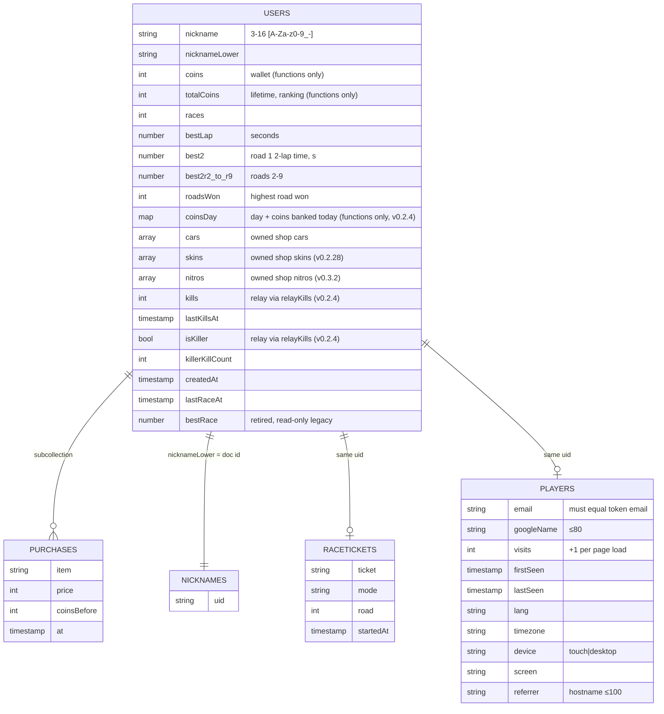

# 8. Data architecture

[← Index](TECHNICAL_DOCUMENTATION.md)

## 8.1 Firestore model

Sources: `firestore.rules`, `functions/index.js`, `src/online/firebase.js`. The data-model comment in `src/online/firebase.js` was brought up to date in v0.2.4 (D5).

| Collection | Read | Write | Writer | Contains PII |
|---|---|---|---|---|
| `users/{uid}` | **public** | create (zero stats), rename, kill award, killer update | client (limited) + functions (Admin SDK, bypasses rules) | nickname only |
| `nicknames/{lower}` | public | create / delete tied to the profile (`getAfter`) | client | no |
| `players/{uid}` | owner only | create / update (`visits` +1, email = token email) | client | **yes**: email, Google display name, device, timezone, referrer |
| `users/{uid}/purchases/{id}` | owner only | none | `buyCar` | no |
| `raceTickets/{uid}` | none | none | `startRace` / `finishRace` | no |

**Indexes:** `firestore.indexes.json` is empty [confirmed]. The leaderboard and rank queries filter and sort on a single field, so automatic single-field indexes are enough [inferred]. What indexes actually exist in production is [unknown].

**Retention / deletion:** no delete paths exist (`allow delete: if false` on `users` and `players`; no account deletion function) [confirmed]. `raceTickets` are deleted on finish; tickets that are never finished are deleted by the daily `cleanRaceTickets` function once older than 45 min (v0.2.4, D12) [confirmed: `functions/tickets.js`]. A data-deletion process for privacy requests is [unknown] (see `public/privacy.html`).

## 8.2 Relay in-memory state (`server/live.js`)

Per connection `p` (`server/live.js:137`): `id` (session counter), `uid`, `name`, `c` (color), `state` (11 numbers), rate windows (`msgs`, `shots`, `hits`), `heard`, `alive`, `kills` (session), `diedAt`, chat token bucket, `firedAt`, `killer`, `kc`, `slot`. Maps: `players` (joined), `byUid` (one connection per account), `conns` (all sockets). **Nothing is persisted.** A relay restart drops all sessions; killer counts survive only because clients save them to their profiles [confirmed].

State vector `s` (`server/live.js:153-162`): `[x, y, z, yaw, pitch(±3.15 since v0.2.22; ±1.6 before), roll(±1.6), speed(−50..400), boost(0..1), nitro(0..1), t, hp(0..100)]`. The semantics of indexes 3 and 9 are [inferred] from `src/online/live.js`.

## 8.3 localStorage

| Key | Value | Written by |
|---|---|---|
| `neon.gfx` | `high` / `low` | `main.js` (settings), `render.js` (auto-gfx) |
| `neon.road` | last road id | `world.js` `ROAD_PICK` |
| `neon.roadsOpen` | locally unlocked roads | `main.js` `ROAD_OPEN` |
| `neon.best`, `neon.best.r<N>` | local best times | `world.js` `bestKey`, `race.js` `completeLap` |
| `neon.paint` | livery index | `main.js` |
| `neon.sens`, `neon.invert`, `neon.vol`, `neon.view` | mouse sensitivity, invert, volume, camera / cockpit | `main.js`; `neon.view` in `camera.js` |
| `neon.car` | equipped car | `shop.js:9` |
| `neon.skin.<car>` | skin worn by that car (v0.2.28; '' = stock) | `shop.js` `SKIN_KEY` |
| `neon.nitro.<car>` | nitro fitted to that car (v0.3.2; '' = stock flames) | `shop.js` `NITRO_KEY` |
| `neon.shopSeen` | NEW badge seen | `shop.js` |
| `neon.kills.<uid>` | unsaved FREE ROAM kills | `account.js:45` |
| `neon.mockdb` | whole mock database (dev `?mock`) | `mock.js` |
| `rr.analytics` | `yes` / `no` consent | `analytics.js:7` |

Exact key spellings are [confirmed] for those with line numbers; the rest come from a `localStorage` grep earlier in this session.

## 8.4 Static assets

`public/models` (car GLBs `car.glb`, `car02.glb`, `car03.glb` and sky props), `public/tex`, `public/fx` (killer aura WebP), `public/ui`, `public/cockpit`, `public/brand`, `public/og-image.jpg`, `public/privacy.html`, `public/terms.html`. Source art lives outside git in `neon_c/Assets` and `neon_c/meshy` [confirmed].
