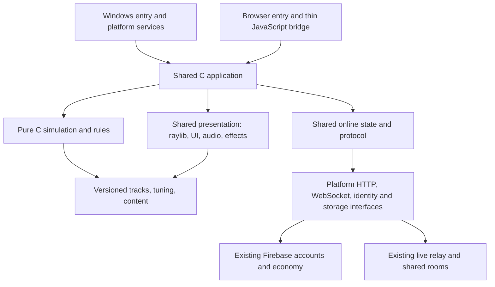

# Architecture

Status: implementation design, 2026-11-02. Product choices are confirmed in `../PROJECT_DIRECTION.md`; technical defaults below are initial implementation choices, not claims of tested compatibility.

## Targets and ownership

Use C17 game sources, raylib 6.2, CMake, and MSVC for native Windows. Build a browser target with Emscripten early, using the same game sources. Windows x64 is the initial development target. Supported Windows releases, GPU minimums, and measured performance requirements remain unconfirmed; 1080p/60 FPS is a provisional measurement target, not a product requirement or guarantee.

Windows leads development after the parity gates pass. Until then, the existing JavaScript browser game remains the playable reference. Do not replace it before the C browser build has passed the same acceptance gates. This agent produces browser-build artifacts and handoff instructions inside `win_app/`; Claude owns changes to `game/`, hosting, and shared backend code.



## Boundaries

| Area | Shared implementation | Platform-specific boundary |
|---|---|---|
| Simulation | C flight, collision, AI, gates, race, coins, combat | Receives normalized input, elapsed time, and incoming events |
| Presentation | raylib scene generation, cameras, HUD, menus, cockpit, effects, audio synthesis | Window/canvas lifecycle, graphics capabilities, user audio gesture |
| Content | Road coordinates, colliders, tuning, car/texture manifests | Asset loading and browser preload paths |
| Online | C message codecs, connection state, remote interpolation, account/profile models | HTTPS, WebSocket transport, identity acquisition, token storage |
| Persistence | C schema, validation, migrations, local preferences | Windows files and protected credentials; browser durable storage |

Keep `core/` free of raylib graphics types, OS headers, browser APIs, Firebase SDKs, and wall-clock reads. Small vector/quaternion types and math live in C. Rendering receives a read-only view of simulation state; rendering must not change collision geometry or gameplay. Network events and platform completions enter queues and are applied on the game thread.

Proposed layout (not all directories exist yet):

```text
src/core/             math, inputs, time, flight, track, collision, AI, combat, race
src/app/              application states, commands, scene ownership
src/presentation/     raylib renderer, UI, cameras, effects, audio
src/online/           protocol, session, profiles, race tickets, purchases
src/platform/         interfaces and Windows/browser implementations
assets/               versioned runtime data and copied/converted assets
shaders/              desktop and WebGL variants of shared effects
tools/                reference capture, content conversion, validation
tests/                headless C parity tests, integration fixtures
scripts/              setup and build entry points
third_party/          pinned dependencies and licenses
reference/            browser revision, source hashes, comparison fixtures
build/                generated output only
dist/                 distributable Windows/browser artifacts
```

## Simulation and browser fidelity

The reference uses metres, Y-up, forward toward -Z, centripetal Catmull-Rom tracks, and shared flight logic for player and AI. Preserve these conventions and the order of operations in the first port. JavaScript numbers are double precision: use `double` for core simulation initially and convert to raylib floats at the presentation boundary. Compare numerical results with explicit tolerances; do not promise bitwise agreement between MSVC, WebAssembly, or JavaScript.

Expose a single C simulation-step function with an explicit `dt`. Initial parity fixtures feed the exact same time/input sequences into reference and C implementations. The current browser clamps frame delta to 1/20 second and steps once per rendered frame. Match that policy initially; moving to a fixed simulation tick would be a gameplay change requiring measured comparison and coordinated adoption in both clients. Rendering at a different FPS must not silently redefine tuning.

Use explicit random state and record random inputs in fixtures. Compare deterministic flight, collision, checkpoint, and combat cases first; the current browser's unseeded randomness means whole-race results are not deterministic. Do not replace random distributions or city placement under the label of a faithful port.

Application states cover startup, menu, road selection, shop, tour, countdown, race/time attack/free roam, paused, results, and recoverable error. Clear held inputs on focus loss. Single-player pauses; online focus/pause behavior must preserve the agreed relay and damage semantics until an intentional cross-client change is approved.

## Graphics, content, UI, and sound

raylib supplies the foundation, not a drop-in replacement for Three.js materials/postprocessing. Port the procedural skyline, flight corridor clearance, gates, city traffic, atmosphere, bloom, fog, tone mapping, and effects explicitly. Preserve collision and gate data even when visual quality is lowered.

Audit the three GLB cars for scale, axis orientation, material maps, alpha, embedded resources, node transforms, and supported extensions before assuming raylib's loader reproduces their appearance. Preserve an identifiable procedural fallback car and useful loading errors. Record every copied or converted asset's source hash and conversion settings. Test whether emissive/HDR render targets and shaders work in both desktop OpenGL and WebGL 2; choose portable alternatives where needed.

Keep UI state, navigation, formatting, and layouts in C, rendered with raylib. Preserve the browser's recognizable menus/HUD and existing controls, rather than reproducing DOM/CSS implementation details. Provide a browser text-input bridge for mobile keyboards, text composition, and chat accessibility. Retain touch/tilt and gamepad support in the future C browser parity scope.

Port the current synthesized audio cues into shared C generation/playback logic. Browser audio activation remains a platform concern. Quality presets control render resolution, effects, and detail, not rules or simulation speed. Enhanced Windows-only visuals are deferred until parity.

## Shared online services

Use the same Firebase project, UID/profile documents, shop ownership, leaderboards, and live-room endpoint. A local development profile is explicitly separate and never uploads a fabricated wallet. Offline settings and best laps can persist locally; trusted coins/purchases/rankings remain server-authorized. A purchased car must resolve to the same ownership on both clients.

Retain the exact callable-function request envelopes and error semantics for `startRace`, `finishRace`, and `buyCar`. Respect Firestore rules and transactions for nicknames and any allowed client updates. Implement a deliberate profile refresh/subscription strategy; a REST read is not equivalent to the browser's Firestore subscription. Handle token expiry, reconnect, duplicate result submission, sign-out, and account switching explicitly.

Desktop identity is an early feasibility gate. The Firebase browser popup cannot simply be called from pure C. Investigate system-browser Google OAuth with the appropriate desktop client configuration, Firebase credential exchange, secure return flow, and token refresh. If a hosted sign-in broker is needed, produce a concrete handoff design for Claude. No embedded service-account key, client secret treated as confidential in an executable, or bypass of existing authorization.

App Check is a separate integration question. The existing browser uses reCAPTCHA Enterprise; this does not establish native desktop attestation. Confirm enforcement state without printing secret environment values, and design a supported provider/broker approach if required. Do not disable backend enforcement or ship debug tokens to make a native client work. Any backend integration change is a coordinated handoff.

The proposed Windows transport is a small C adapter using WinHTTP for HTTPS and WebSocket operations; validate its cancellation and concurrency model in the early network spike. The browser uses browser transports through a thin bridge. Keep token acquisition and transport mechanics outside shared game rules. Never block the render thread on sign-in, downloads, or profile requests.

## Live protocol compatibility

The captured source declares live protocol 6, 15 position sends/second, 150 ms remote interpolation, and rooms capped at 24 players. These are reference values, not permission to change the relay. Encode the existing JSON fields, units, timestamp rules, rate limits, hit events, chat, killer status, and error handling exactly. Validate packet sizes and input values before applying them to game state.

Protocol mismatch on Windows must report an update requirement and stop retrying incompatible messages; the browser's page-reload behavior is not an updater for a native executable. Handle the existing duplicate-session behavior when the same account joins from both clients. Cross-play tests use two distinct real test accounts.

Known client-trusted hit/kill behavior remains a documented limitation of the reference. A C executable does not turn the client into a trusted authority. Server-authoritative combat, different pause semantics, and protocol extensions are separate coordinated projects, not unannounced port changes.

## Builds, dependencies, and lifecycle

Pin raylib to release 6.2, source commit `02566453880e06bec97f5b8160fa6fe1e98397ca`. The Windows bootstrap verifies the official x64 MSVC archive hash. Future source builds use that immutable commit; browser builds pin a tested Emscripten toolchain once validated. Keep optional build/download tooling outside the runtime. Game implementation stays C; shaders and thin browser integration are necessary complementary formats.

Build Windows and browser from one content revision. Compile a headless C test target without raylib. Use compiler warnings, checked lengths for network/content input, explicit resource ownership, and clean shutdown. Persist settings with a schema version and atomic file replacement on Windows. Store refresh credentials using OS protection; never store them in ordinary settings or logs. Browser durable storage has explicit flush and recovery behavior.

## Validation and unresolved items

Use reference input traces, checkpoint/track fixtures, collision examples, weapon timing cases, and comparable screenshots. Report exact reference hash, dt sequence, tolerance, and tested build. Test mixed browser/Windows free roam against a staging relay, then validate approved production integration through Claude's deployment process.

Release requirements still need measured minimum hardware, supported Windows/browser versions, installer/signing/update choices, and a proven identity/App Check integration. These do not block headless flight/content work, but they block claims of complete product readiness.

## Primary technical references

- [raylib 6.2 release](https://github.com/raysan5/raylib/releases/tag/6.2)
- [raylib browser build guidance](https://github.com/raysan5/raylib/wiki/Working-for-Web-(HTML5))
- [Emscripten C/JavaScript interoperability](https://emscripten.org/docs/porting/connecting_cpp_and_javascript/)
- [Firebase Google sign-in and manual credential integration](https://firebase.google.com/docs/auth/web/google-signin)
- [Firebase custom App Check providers](https://firebase.google.com/docs/app-check/custom-provider)
- [Windows WinHTTP](https://learn.microsoft.com/en-us/windows/win32/winhttp/about-winhttp)

